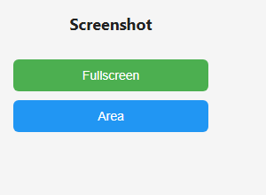

# PicShot

**A lightweight Chrome extension for capturing the visible tab or a selected area as a PNG.**

[](./LICENSE)
[](./manifest.json)
[](https://developer.mozilla.org/en-US/docs/Web/JavaScript)
[](https://github.com/M003aad/PicShot/actions/workflows/ci.yml)

## Table of Contents

- [Overview and architecture](#overview-and-architecture)
- [Features](#features)
- [Screenshots](#screenshots)
- [Codebase breakdown](#codebase-breakdown)
- [Permissions](#permissions)
- [Installation and setup](#installation-and-setup)
- [Usage](#usage)
- [Messaging and API reference](#messaging-and-api-reference)
- [Contributing](#contributing)
- [Security](#security)
- [License](#license)

## Overview and architecture

PicShot is a browser extension that captures the current visible tab or lets you drag a rectangle to capture part of that view. It is implemented in plain JavaScript, HTML, and CSS; it has no framework, bundler, backend, or external HTTP API. The manifest uses Chrome's Manifest V3 format and declares a background service worker.

The popup in `popup.html` and `popup.js` offers the Fullscreen and Area actions. `background.js` handles extension messages and uses `fullscreen.js` for visible-tab capture. For area capture, the service worker captures the visible tab, injects `content.js` to display the selection overlay and crop the image, then downloads the PNG. The extension has no options page.

## Features

- Capture the current visible tab as a PNG.
- Select and capture a rectangular area of the current visible tab.
- Download captures through the browser's download manager, with a save dialog.

The fullscreen action captures the visible viewport; it does not stitch or capture the entire scrollable page.

## Screenshots



*The PicShot popup UI.*

## Codebase breakdown

```text
.
├── .editorconfig
├── .gitattributes
├── .gitignore
├── .github/
│   ├── ISSUE_TEMPLATE/
│   │   ├── bug_report.md
│   │   └── feature_request.md
│   ├── workflows/
│   │   ├── ci.yml
│   │   └── release.yml
│   └── PULL_REQUEST_TEMPLATE.md
├── .prettierrc
├── icons/
│   └── icon128.png
├── area.js
├── background.js
├── CODE_OF_CONDUCT.md
├── CHANGELOG.md
├── CITATION.cff
├── CONTRIBUTING.md
├── content.js
├── eslint.config.js
├── fullscreen.js
├── LICENSE
├── manifest.json
├── popup.css
├── popup.html
├── popup.js
├── Prompt.txt
├── README.md
├── screenshots/
│   └── picshot-popup.png
├── SECURITY.md
└── SUPPORT.md
```

| Path | Purpose |
| --- | --- |
| `manifest.json` | Manifest V3 metadata, permissions, service worker, popup, and icons. |
| `background.js` | Handles popup/content messages, captures tabs for area selection, injects the selector, and starts downloads. |
| `fullscreen.js` | Captures and downloads the current visible tab when called by the background service worker. |
| `content.js` | Adds the page overlay, collects the selected rectangle, crops the captured image, and requests a download. |
| `area.js` | An additional area-capture implementation in the repository; it is not referenced by the manifest or the active message flow. |
| `popup.html`, `popup.js`, `popup.css` | Popup markup, action handlers, and styling. |
| `icons/` | Extension icon assets. |
| `screenshots/picshot-popup.png` | Screenshot of the extension popup. |
| `LICENSE` | GNU Affero General Public License, version 3. |
| `Prompt.txt` | Repository prompt/documentation instructions. |
| `.github/` | Issue and pull-request templates plus CI and release workflows. |
| `CHANGELOG.md`, `CITATION.cff`, `CODE_OF_CONDUCT.md`, `CONTRIBUTING.md`, `SECURITY.md`, `SUPPORT.md` | Project history, citation metadata, community standards, contribution guidance, and support/security policies. |
| `.editorconfig`, `.gitattributes`, `.gitignore`, `.prettierrc`, `eslint.config.js` | Editor, line-ending, ignore, formatting, and lint configuration. |

## Permissions

The manifest declares no host permissions.

| Permission | Why it is used |
| --- | --- |
| `tabs` | Find the active tab in the current window before area-capture injection. |
| `activeTab` | Grant temporary access to the active tab following the user's popup action. |
| `downloads` | Save captured PNG data using the browser download manager. |
| `scripting` | Inject the area-selection script and pass the captured image data to the page. |

## Installation and setup

### Install from a release

1. Download `PicShot.zip` from the latest [GitHub Release](https://github.com/M003aad/PicShot/releases).
2. Extract the archive.
3. In Chrome, open `chrome://extensions/` and enable **Developer mode**.
4. Select **Load unpacked** and choose the extracted folder containing `manifest.json`.

The release archive contains only the manifest and files required to run the extension; it excludes documentation, development configuration, and unused source files.

### Work from source

```sh
git clone https://github.com/M003aad/PicShot.git
cd PicShot
```

There are no runtime dependencies, environment variables, or build step. To load the source version, enable **Developer mode** on `chrome://extensions/`, select **Load unpacked**, and choose the cloned repository folder.

The manifest targets Chrome's extension APIs. The repository does not define a separate build command.

## Usage

1. Open a web page and select the PicShot toolbar icon.
2. Choose **Fullscreen** to save a PNG of the current visible tab, or choose **Area** to start selecting.
3. For an area capture, drag across the visible page to draw the rectangle. The selected pixels are saved as a PNG.
4. Choose a location in the browser's download dialog.

## Messaging and API reference

All messages use `chrome.runtime.sendMessage` and are handled by the background service worker. There are no backend routes or external HTTP APIs.

| Action | Direction | Payload | Result |
| --- | --- | --- | --- |
| `FULLSCREEN` | Popup → service worker | `{ "action": "FULLSCREEN" }` | Captures the current visible tab and opens the download dialog for `screenshot.png`. |
| `AREA_START` | Popup → service worker | `{ "action": "AREA_START" }` | Captures the visible tab, injects the image data into the page, and injects `content.js` to begin selection. |
| `DOWNLOAD` | Content script → service worker | `{ "action": "DOWNLOAD", "url": "<PNG data URL>", "filename": "area-screenshot.png" }` | Downloads the supplied data URL; `filename` defaults to `screenshot.png` if omitted. |

The service worker does not send a response payload for these actions.

## Contributing

See [CONTRIBUTING.md](./CONTRIBUTING.md) for local setup, bug reports, feature proposals, and pull-request guidance.

## Security

For private vulnerability reports and supported-version information, see [SECURITY.md](./SECURITY.md).

## License

PicShot is distributed under the GNU Affero General Public License, version 3. See [LICENSE](./LICENSE). Maintained by M003aad.
